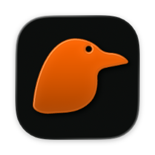
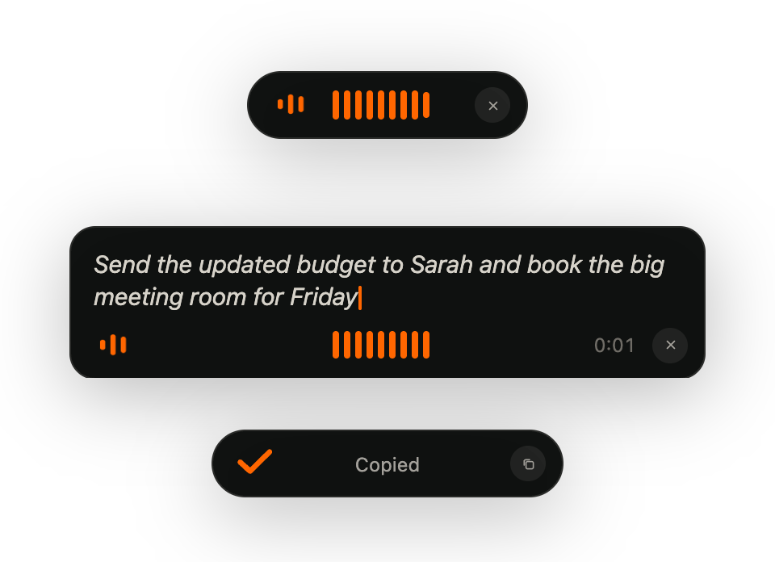
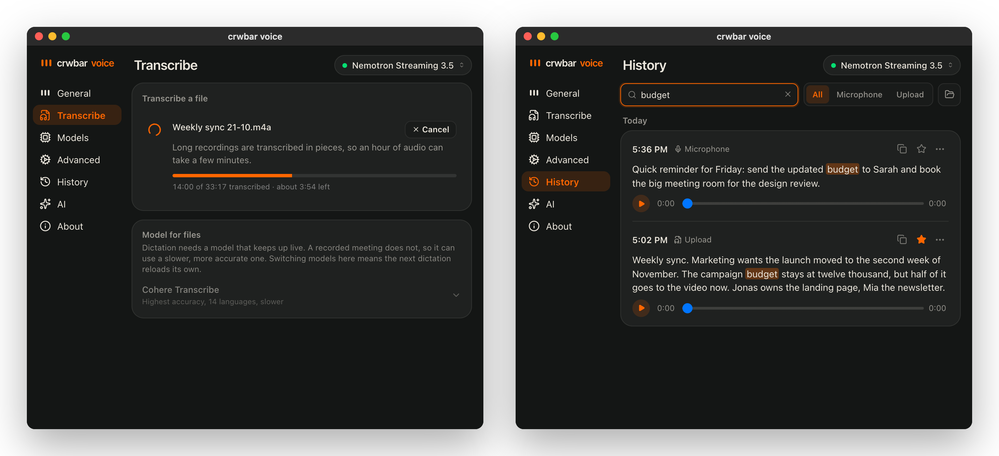

<p align="center"></p>

<h1 align="center">crwbar voice</h1>

<p align="center">
Hold a shortcut, speak, and the text lands where you're typing — transcribed on your Mac, not in the cloud.<br>
Drop in a voice note or a recorded meeting, and find anything you ever said again.
</p>

## Dictation

<p align="center"></p>

Hold **⌥ Space** and speak. A small bar at the bottom of the screen shows it's
listening — on macOS 26 in Liquid Glass — and with a streaming model the words
appear while you say them. Let go and the text is pasted into the app you were
typing in.

- **⌥ C** copies the last transcript, **⌥ V** inserts it again. Both can be
  reassigned or switched off.
- **Esc** cancels. What was said up to then is kept in History.
- **Keep Recording After Release** _(General)_ adds up to two seconds, so the
  last word isn't cut off.
- **Lower Audio While Recording** _(General)_ fades music and calls down while
  you speak, at the speed you choose.

## Files and History

<p align="center"></p>

The **Transcribe** tab takes a recording — drop it in or pick it — and
transcribes it inside the app instead of typing into another window. Long
meetings are split into pieces, with the time left measured on your Mac, and a
run you stop keeps what it has done. Files can use their own model: a slower,
more accurate one for recordings, a fast one for dictation.

**History** keeps every transcript, grouped by day, and searches all of them —
case, word order and umlauts don't matter. The newest ten recordings keep their
audio as well; re-transcribe or delete from an entry's **…** menu.

**Models** shows which model does what: the one marked _Dictation_ runs when you
speak, the one marked _Files_ handles recordings. Downloads show their progress
in place.

Imports: WAV, MP3, M4A (AAC and Apple Lossless), FLAC, OGG, Opus and CAF —
WhatsApp voice notes and Apple Voice Memos included.

## Contents

- [Install](#install)
- [Shortcuts](#shortcuts)
- [Privacy](#privacy)
- [Limits](#limits)
- [Development](#development)
- [Credits](#credits)
- [License](#license)
- [Disclaimer](#disclaimer)

## Install

Download the **.dmg** from the [latest release](../../releases/latest), open it
and drag crwbar voice to Applications. It runs on Apple silicon, built for
macOS 11 and later and tested on macOS 26.

crwbar voice isn't notarized by Apple, so macOS won't open it the first time.
Go to **System Settings → Privacy & Security**, scroll down and click **Open
Anyway**. Or, in Terminal:

```bash
xattr -dr com.apple.quarantine "/Applications/crwbar voice.app"
```

Then:

1. **Microphone**: allow it when asked.
2. **Accessibility**: allow crwbar voice under System Settings → Privacy &
   Security → Accessibility. It's what makes the global shortcut work and lets
   the text be pasted. After an update, remove it there with "−" and add it
   again — macOS drops the permission when the app is replaced.
3. **A model**: pick one on first launch. It's downloaded once and runs on your
   Mac from then on.

Coming from Handy? On first launch crwbar voice can take over your existing
models, settings and history. Handy's own data stays where it is.

## Shortcuts

| Shortcut | What it does                                                         |
| -------- | -------------------------------------------------------------------- |
| ⌥ Space  | dictate — hold to talk, or switch push-to-talk off to press to start |
| ⌥ C      | copy the last transcript                                             |
| ⌥ V      | insert the last transcript; your clipboard is put back afterwards    |
| Esc      | cancel; the text so far goes to History                              |

All of them can be changed in _General_; the ✕ next to one switches it off.

## Privacy

Speech is transcribed on your Mac and audio never leaves it. There's no account,
no analytics and no update check, and transcripts aren't written to the log.
The app goes online for two things: downloading a model you choose, and — only
if you switch on _AI_ — post-processing and voice actions, which send the
_text_ to the provider or CLI you set up. With _AI_ off, nothing is sent.

## Limits

- **macOS only.** The Windows and Linux targets come from Handy and haven't
  been tested, so there are no builds for them.
- **Not notarized**, so Accessibility has to be granted again after each update.
- **The model list is built into each release.** New models arrive with an
  update, not on their own.
- **A crash mid-transcription loses that run.** Cancelling keeps the text;
  only a hard crash doesn't.
- **Search highlights the raw text.** A word found only in AI-post-processed
  text still finds the entry, but isn't marked.

## Development

You need current stable Rust and [Bun](https://bun.sh/).

```bash
bun install
bun run tauri dev
```

| Command                                  | What it does                                               |
| ---------------------------------------- | ---------------------------------------------------------- |
| `bun run verify`                         | typecheck, lint, formatting, translations, build           |
| `cargo test` (in `src-tauri/`)           | the Rust tests                                             |
| `bun run tauri build`                    | the app and the DMG                                        |
| `cargo run -- --transcribe-file <audio>` | transcribe a file without the UI, through the same decoder |
| `bun scripts/readme-shots/shoot.ts`      | redraw the images in this README from demo data            |

[AGENTS.md](AGENTS.md) explains how the app is put together and where it's easy
to go wrong; [BUILD.md](BUILD.md) covers building in more detail.

## Credits

crwbar voice is built on the complete codebase of
[Handy by CJ Pais](https://github.com/cjpais/Handy) — a refinement with its own
fixes, workflow and look, not a rewrite. It has its own name, bundle identifier,
icon and artwork, and isn't affiliated with or endorsed by the Handy project.

## License

MIT, see [LICENSE](LICENSE). Handy's copyright and contribution history are
kept intact.

## Disclaimer

- **Made with AI.** The changes in this fork were made with Claude, Anthropic's
  AI model, and tested by hand on a Mac. Handy itself is the work of CJ Pais and
  its contributors.
- **Unofficial.** Not affiliated with the Handy project or with the makers of
  the speech models it runs. Their names are used only to say what works.
- **Your data.** Recordings, transcripts and settings stay on your Mac.
- **Permissions.** It needs the microphone and Accessibility. Like any app with
  that access it can do a lot; the code is here to read.
- **No warranty.** It's provided as is, as the license says.
